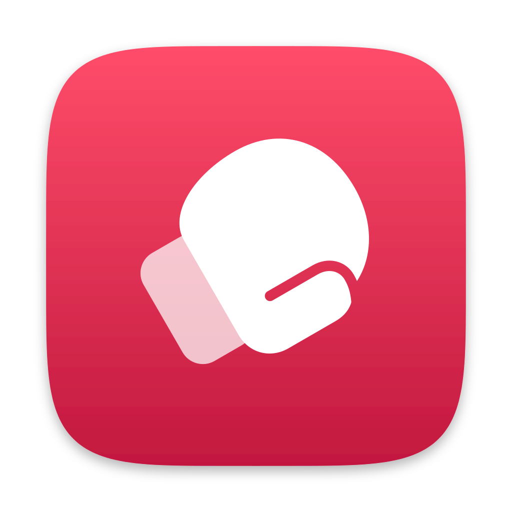

# knockout

Lets your other Macs knock this one out: it shuts down when one of them
tells it to, through [crosstalk](https://github.com/dittofleet/crosstalk).
Made for outages and emergencies, when the Mac is out of reach and has to
go off now.

```sh
$ crosstalk send lychee knockout '{"do":"shutdown"}'
"shutting down"
```

The shutdown is clean but does not wait for anyone: every process is told
to quit, the ones still running after a while are killed, and the disks are
synced and unmounted. Apps get no chance to ask about unsaved changes, so
nothing can hold it up. Those changes are lost.

## Install

On the Mac to be shut down, with crosstalk already installed and joined:

```sh
curl -fsSL https://raw.githubusercontent.com/dittofleet/.github/main/install.sh | sh -s knockout
```

Installs the latest release to `~/.local/bin/knockout` (override with
`KNOCKOUT_INSTALL_DIR`), then runs `knockout setup`. It:

- starts a launchd agent that runs at login and listens on the crosstalk
  name `knockout` (log in `~/Library/Logs/knockout.log`)
- asks for your password once, to add a sudo rule that lets you run
  `/sbin/shutdown -h now`, and only that, without one
  (`/etc/sudoers.d/knockout`)

Run `knockout setup` again if either goes missing. Nothing needs
installing on the Macs that send.

## Messages

```sh
crosstalk send <mac> knockout '{"do":"shutdown"}'   # replies "shutting down", then does
crosstalk send <mac> knockout '{"do":"check"}'      # replies "ready", or why not
```

Anything else is refused. The reply goes out before the shutdown starts, so
it arrives. A Mac that is asleep or offline does not get the message, and
crosstalk says so.

Send to one Mac by name, not with `crosstalk send --all`. A broadcast shuts
down every other connected Mac that runs knockout, and gets no replies, so
you cannot tell which ones went down.

Any Mac with your crosstalk key can send these, and so can anything running
as you on one of them.

## Updating and uninstalling

knockout updates itself: at most once a day, after a command, it installs
a newer release if one is out and restarts the daemon. It skips the check
when `CI` or `KNOCKOUT_NO_UPDATE_CHECK` is set or stderr is not a
terminal. `knockout update` does the same right away.

`knockout uninstall` stops the daemon and removes the sudo rule (asking
for your password) and the binary, after asking (`--yes` skips the prompt).

## Development

`go test ./...`
